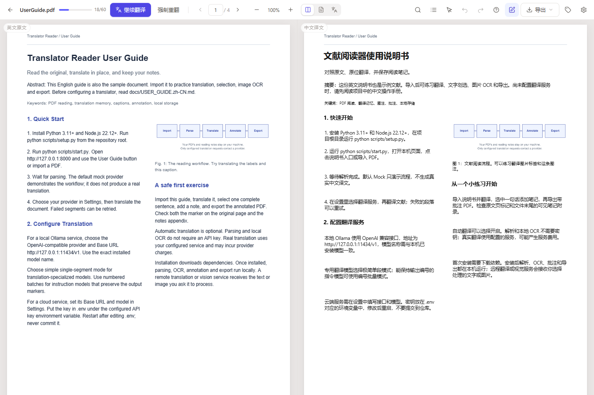
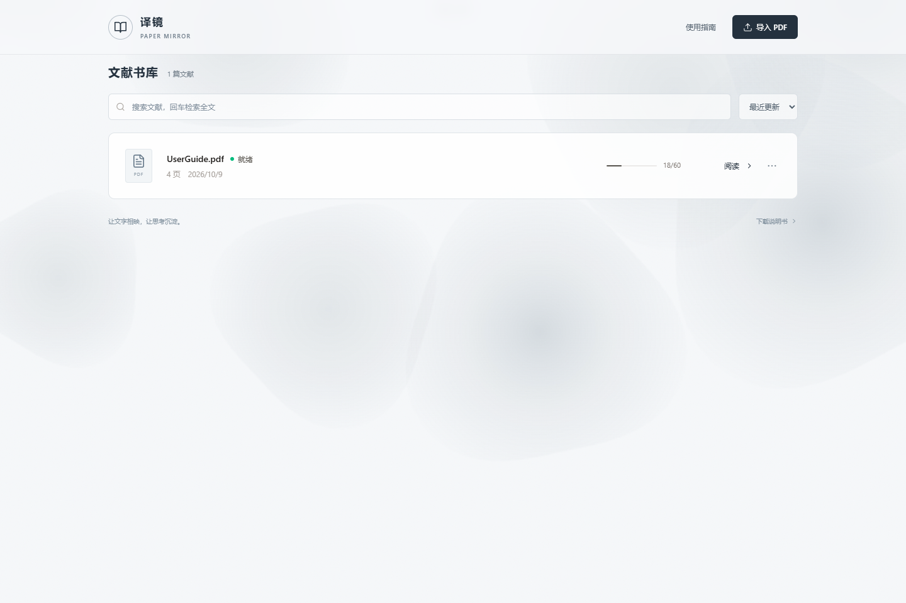

# paper-mirror · 译镜

**让论文原文与译文相互映照，边读边记。**

在同一份 PDF 上对照原文与译文：精确划选、独立高亮、记录笔记，并导出带可见笔记的 PDF。
文献、译文和批注保存在本机；翻译服务由你选择。

Local-first bilingual PDF reader for papers: read the original and translation side by side, highlight, annotate, and export.

[功能](#功能) · [界面](#界面) · [快速开始](#快速开始) · [平板镜像站](#平板镜像站可选) · [配置](#配置翻译与识别) · [数据与隐私](#数据隐私与备份) · [开发](#开发与验证) · [文档](#文档) · [许可](#许可证与致谢)

> 截图使用项目生成的说明书和人工编写的离线演示译文，不代表模型翻译质量评测。

> 项目仍在迭代：数据库结构和接口可能调整。升级前请按[数据与隐私](#数据隐私与备份)备份整个 `data/` 目录。

## 为什么做这个

读论文时，原文、译文和笔记通常散落在三个工具里：PDF 阅读器负责版式，翻译器负责文字，笔记软件负责记录。来回切换不仅打断思路，划词翻译还经常打乱公式、图表和参考文献。

paper-mirror 换了一个思路：**不生成一份新的译文 PDF，而是在原文旁边叠加一份几何一致的译文视图。**

- 左栏是原始 PDF，右栏是同一页的中文覆盖层；两栏滚动 1:1 镜像，点段落两边同时定位。
- 译文按段落重排，保留标题层级、图表位置和编号；参考文献保留原文，不参与翻译。
- 每次划选独立保存颜色、引文和行矩形，批注可以写回 PDF，也可以导出为 Markdown / JSON。

## 功能

| 模块 | 能力 |
| --- | --- |
| **双栏阅读** | 原文 / 译文 / 单栏切换，双向同步滚动，手形平移，Ctrl+滚轮缩放，目录、全文搜索、阅读位置记忆 |
| **PDF 解析** | 可复制文字 PDF 的双栏顺序重建，标题字号与加粗，图注、表注、公式占位，旋转页面坐标归一化 |
| **图片与图注** | 文字层优先；图片走本地 RapidOCR（PP-OCRv4）；关联图注一并翻译，旧文档遗漏的原生图注可补回 |
| **批注与笔记** | 每次选区独立身份、颜色、引文和矩形；段落摘录、页笔记、全文笔记；Ctrl+Z / Ctrl+Shift+Z 撤销重做阅读操作 |
| **导出** | 双语 / 纯译文 / 原文 Markdown，结构化 JSON，以及写入原生高亮和可见笔记附录的 PDF |
| **翻译服务** | 离线 Mock、本地 Ollama、任意 OpenAI 兼容接口；术语表、翻译记忆、按术语与目标语言区分的缓存 |
| **可选增强** | DocLayout-YOLO 版面检测；平板镜像站（静态发布 + 批注回流） |

## 界面

| 文献库 | 使用说明书 |
| --- | --- |
|  |  |

## 快速开始

需要 **Python 3.11+、Node.js 22.12+（含 npm）**。Windows 是主要验证平台；Linux/macOS 使用相同的 Python 入口，验证范围见[安装文档](docs/INSTALL.md)。

在克隆后的项目根目录运行：

~~~sh
python scripts/setup.py --check-only
python scripts/setup.py
python scripts/start.py
~~~

打开 **<http://127.0.0.1:8000>**。Windows 也可以使用 PowerShell 包装脚本：

~~~powershell
powershell -ExecutionPolicy Bypass -File scripts\setup.ps1
powershell -ExecutionPolicy Bypass -File scripts\start.ps1
~~~

安装脚本会创建 `.venv`、安装后端依赖、按锁文件安装并构建前端、生成练习 PDF。**不会**下载语言模型或版面权重；安装依赖需要联网，之后的基础解析、OCR、批注和导出都在本机运行。

第一次打开时，点击首页的 **使用指南** 导入内置说明书（它同时是可练习翻译、划选和导出的英文文献），或者直接拖入自己的 PDF。默认的 **Mock** 只演示流程，**不会生成真实中文译文**；在“设置”里选择翻译服务后才会产生真实译文。

- [中文操作手册](docs/USER_GUIDE.zh-CN.md)：不需要先配置翻译服务。
- [四页 PDF 说明书](docs/UserGuide.pdf)：同时是可导入的英文练习文献。
- [详细安装、模型和排错](docs/INSTALL.md)。
- [Agent 安装与开发指引](AGENTS.md)：可以直接交给 coding agent。

## 平板镜像站（可选）

把电脑上已翻译的文献导出成静态站点，部署到 Cloudflare Pages 后，平板或手机无需连接家中主机即可阅读、划选和记笔记；批注可以自动回流，也可以导出 JSON 手动合并。

~~~sh
npm --prefix frontend run build
python scripts/publish_site.py          # 生成 site/
python scripts/serve_site.py            # 本地预览 http://127.0.0.1:8010
~~~

镜像站是**只读发布**：不能导入新 PDF、调用翻译或重新解析。发布产物会去掉本机绝对路径，但论文、译文、批注和笔记会原样公开，**发布前请确认内容可以公开**。完整步骤、自动同步、安全边界和常见问题见 [平板镜像站文档](docs/MIRROR.md)。

基础安装不需要 Cloudflare 账号；不部署镜像站不影响本机使用。

## 配置翻译与识别

复制 `.env.example` 为 `.env`，在本机填入密钥；然后在应用的“设置”里配置 Base URL、模型名称、密钥环境变量和协议。修改 `.env` 后需要重启应用。

| 场景 | 配置方式 |
| --- | --- |
| 离线体验 | 默认 Mock；不需要密钥，译文是演示占位内容 |
| 本地 Ollama | OpenAI 兼容接口；Base URL 为 `http://127.0.0.1:11434/v1`；模型名必须与本机已安装模型一致 |
| 云端文本翻译 | 使用服务商的兼容接口、模型及密钥；段落文本会发送给该服务 |
| 图片文字 OCR | RapidOCR / PP-OCRv4 在本机识别；识别后的文字交给文本翻译服务 |
| 手动视觉识别 | 使用独立的视觉服务配置；所选图片区域会发送给该服务 |

翻译特化模型通常选 **极简单段**；能够保留编号标记的指令模型可选 **编号批量**。Ollama 的接口配置见 [官方兼容文档](https://docs.ollama.com/api/openai-compatibility)。界面里的模型默认值只是配置，应用不会安装或启动这些模型。

文本、视觉、OCR 和版面检测都提供扩展接口，详见[模型接入指南](docs/MODEL_ADAPTERS.md)。默认实现保持兼容；非兼容接口需要编写并注册适配器。

### 可选版面模型

默认启发式解析可以直接运行。需要 DocLayout-YOLO 定位图表和图注时：

~~~sh
python scripts/setup.py --with-layout
~~~

这会额外安装 PyTorch 等依赖，并从官方模型仓库下载 DocStructBench 权重。不需要 GPU，版面推理使用 CPU。模型及安装来源见 [DocLayout-YOLO 官方项目](https://github.com/opendatalab/DocLayout-YOLO)。

## 数据、隐私与备份

所有运行数据默认在 `data/`，也可以通过 `APP_DATA_DIR` 指定目录。仓库忽略数据库、原始文献、模型权重、虚拟环境和 `.env`。

- 应用本身没有账号体系，也不上传遥测；只有你配置的翻译 / 视觉服务会收到对应文本或图片区域。
- **完整备份**：停止应用后复制整个数据目录，并另行安全保管 `.env`。只复制 `app.db` 会漏掉原文 PDF、WAL 和模型权重。
- JSON 导出是单篇文献的结构化归档，**不是完整数据库备份**。
- 局域网模式只监听可信网络：`python scripts/start.py --lan` 会打印带配对令牌的链接，连接设备必须持有令牌。不要把该链接公开分享。
- 通过 Cloudflare Tunnel 等域名访问时，需要在 `APP_TRUSTED_HOSTS` 中显式放行；生产模式固定一个 worker，面向个人阅读，不适合直接开放到公网。
- 镜像站是公开 URL，同步密钥会随站点发布；请用 Cloudflare Access 等额外验证保护，详见 [平板镜像站](docs/MIRROR.md#5-安全边界)。

重新解析会清空当前段落译文，保留笔记和批注并尝试按引用重新挂接；原文和术语相同的真实翻译记忆可以复用。仅缺图注时，优先再次“翻译图片及图注”，无需重新解析。

## 已知限制

- 整页扫描件的批量 OCR 管线尚未实现；可以框选局部区域处理。
- 复杂表格只保留结构占位，不做完整结构翻译。
- JSON 一键恢复尚未实现；重新导入 PDF 会走正常解析流程。
- PDF 导出包含**原文页面、原生批注和可见笔记附录**，不包含浏览器中的译文覆盖层；需要译文请导出 Markdown。
- 平板镜像站为只读浏览，批注保存在浏览器本地，换浏览器或清理站点数据会丢失（可先导出 JSON）。
- 当前面向单人、本机、单 worker 使用；没有多用户权限、协同编辑或公网部署加固。

## 开发与验证

~~~sh
python scripts/run_tests.py
npm --prefix frontend run build
npm --prefix frontend run test:history
npm --prefix frontend run test:browser
git diff --check
~~~

后端、文档语义和发布检查使用临时数据库与本地服务替身，不改用户文献，也不调用付费 API。浏览器检查使用 Playwright：Windows 默认使用已安装的 Edge，其他平台需要安装 Chromium，详见[安装文档](docs/INSTALL.md#测试与开发)。

开发模式：

~~~powershell
powershell -File scripts\dev-backend.ps1
# 另一个终端
powershell -File scripts\dev-frontend.ps1
~~~

前端默认在 `:5173`，将 `/api` 代理到 `:8000`；生产启动由 FastAPI 托管构建后的前端。

~~~text
backend/app/          FastAPI、SQLModel / SQLite、解析、翻译、OCR、导出
backend/app/routers/  文档、区域、批注和导出 API
frontend/src/         React、TypeScript、PDF.js、Tailwind CSS
frontend/src/mirrorStore.ts  静态镜像模式与 localStorage 批注
scripts/              安装、启动、说明书生成、镜像站发布与隔离测试
functions/            Cloudflare Pages Functions（可选的批注同步）
docs/                 用户文档、PDF 说明书和公开演示截图
data/                 本机运行数据，不提交到 Git
~~~

## 文档

| 文档 | 内容 |
| --- | --- |
| [中文操作手册](docs/USER_GUIDE.zh-CN.md) | 阅读、划选、批注、导出和排错 |
| [PDF 说明书](docs/UserGuide.pdf) | 四页英文练习文献，可直接导入 |
| [安装与配置](docs/INSTALL.md) | 手动安装、模型、端口、数据目录和常见问题 |
| [平板镜像站](docs/MIRROR.md) | 静态发布、Cloudflare 部署、批注回流与安全边界 |
| [模型接入](docs/MODEL_ADAPTERS.md) | 文本、视觉、OCR、版面适配器接口 |
| [Agent 指引](AGENTS.md) | 仓库地图、数据边界和验证命令 |
| [发布检查](docs/RELEASE.md) | 上传 GitHub 前的检查清单 |
| [第三方说明](docs/THIRD_PARTY.md) | 依赖与模型的上游许可 |

## 贡献与反馈

欢迎提交问题、改进文档或补充回归测试。开始前请阅读 [贡献指南](CONTRIBUTING.md)；安全问题请按 [安全策略](SECURITY.md) 私下报告，不要在公开 issue 中粘贴令牌、私有论文或 `app.db`。

提交问题时请附上操作步骤、期望与实际结果、系统 / 浏览器版本，以及去掉密钥和私有内容后的错误信息。解析问题可以附自己有权分享的最小 PDF。

## 许可证与致谢

本项目自有源码按 [MIT License](LICENSE) 发布；依赖和模型保留各自的许可证。尤其 **PyMuPDF 使用 AGPL / 商业双许可**，DocLayout-YOLO 使用 **AGPL-3.0**，MIT 不替代这些依赖的授权条件。分发组合程序前请核对[第三方说明](docs/THIRD_PARTY.md)和上游条款。

感谢 PyMuPDF、PDF.js、RapidOCR、DocLayout-YOLO、FastAPI、React 和 Playwright 的维护者。截图仅使用项目生成的示例文献。
